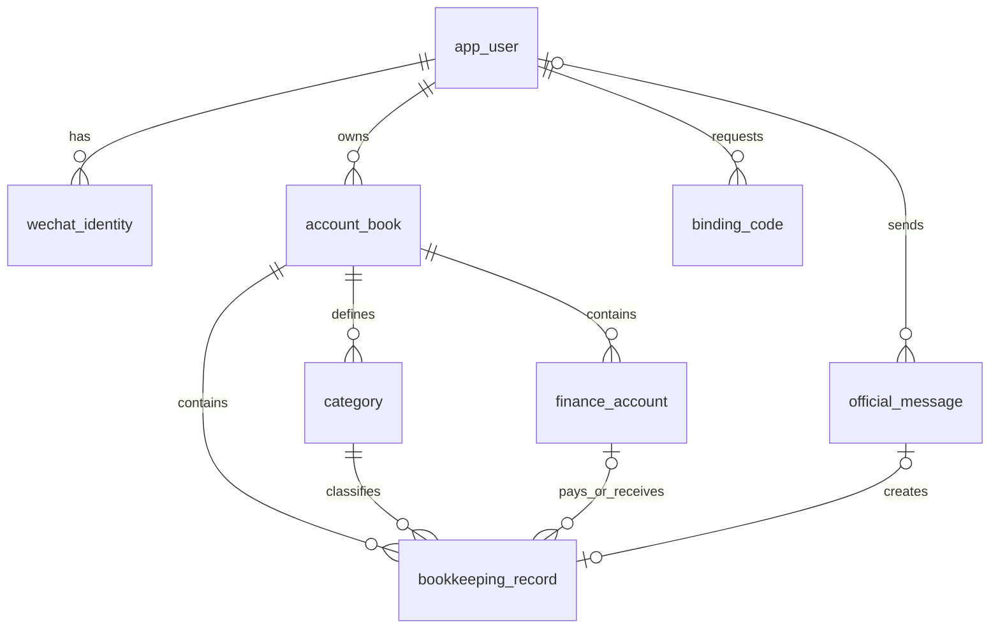

# 记账小程序数据库设计（第一版）

适用场景：微信用户向公众号发送文字消息，后端将消息解析为收入或支出；小程序查看、修改账目；Vue 管理端处理用户、分类和解析失败消息。

建表脚本：[db/schema.sql](../db/schema.sql)。目标版本为 MySQL 8.0.16 及以上。表统一使用 InnoDB、`utf8mb4`；金额用 `DECIMAL(18,2)`，不要用浮点数保存金额。

## 核心关系

## 表的作用

| 表 | 作用 |
| --- | --- |
| `app_user` | 小程序业务用户；可保存用于跨公众号和小程序识别用户的 UnionID。 |
| `wechat_identity` | 一个用户在公众号或小程序下的 AppID + OpenID 映射。 |
| `account_book` | 用户的账本；第一版创建一个默认账本。 |
| `category` | 收入、支出分类，例如工资、餐饮。 |
| `finance_account` | 现金、微信钱包、银行卡等资金账户；首版可以不选。 |
| `binding_code` | 无法用 UnionID 自动关联时，提供短时有效的一次性绑定码。 |
| `api_session` | 小程序服务端会话，仅保存随机令牌的摘要。 |
| `official_message` | 公众号收到的文字及解析状态；保留未识别或未绑定的消息。 |
| `bookkeeping_record` | 实际的收入、支出账目。 |
| `admin_user` | Vue 管理端的独立登录账号。 |

## 公众号入账流程

1. 收到消息后，先校验微信回调签名并解密，再用 `(official_app_id, wechat_msg_id)` 插入 `official_message`。唯一约束让重复推送无法重复创建消息。
2. 用公众号的 `(AppID, OpenID)` 查 `wechat_identity`，确定 `app_user` 和默认 `account_book`。未绑定时将消息标为 `NEEDS_REVIEW`，不猜测归属。
3. 解析“午饭 28”“工资收入 8000”等文字。金额、方向或分类不确定时，将候选值放在 `parse_result`，标为 `NEEDS_REVIEW`。
4. 解析成功后，在一个数据库事务中写入 `bookkeeping_record`，并把消息标为 `POSTED`。`source_message_id` 的唯一约束保证同一消息最多生成一条账目。
5. 管理端可查看 `NEEDS_REVIEW` / `FAILED` 消息，修正后再入账；小程序读取 `bookkeeping_record`。

## 设计约定

- 公众号与小程序的 OpenID 不能直接互用。若两个应用可取得同一 UnionID，关联到同一个 `app_user`；否则由小程序生成绑定码，让用户发送给公众号。绑定码建议使用随机值、短有效期、尝试次数限制；数据库只保存带服务端密钥的摘要。
- `category` 的 `(book_id, type, id)` 与账目使用组合外键，数据库会阻止把支出记到收入分类或其他账本的分类。账户也用组合外键防止跨账本引用。
- 金额始终存正数；`type` 表示收入或支出。查询时过滤 `deleted_at IS NULL`。分类和账户停用即可，避免删除后破坏历史账目。
- `bookkeeping_record.purpose` 保存用户输入或公众号解析出的具体用途；分类仍可统一为“其他”，未来再加入分类功能。
- 资金账户余额由 `opening_balance + 收入 - 支出` 计算；首版不保存可被重复更新的余额字段。
- 业务服务还要校验用户对账本的所有权，并校验金额上限、时间范围、分类是否启用。这些规则不能仅依靠数据库外键。
- 目前只设计收入和支出。一笔消息对应一笔账目；转账、多人共享账本、周期记账、票据图片与审计日志可在需求明确后增加。

## Redis 使用建议

Redis 保存可过期、可重建的运行时数据；账目、公众号原始消息、用户绑定关系仍以 MySQL 为准。第一版建议从以下三类开始：

| 场景 | 示例 Key | 用法 |
| --- | --- | --- |
| 登录会话 | `auth:session:{sessionId}` | 保存管理端或小程序的服务端登录状态，设置过期时间；退出登录时删除。若最终采用无状态登录令牌，则此项可以省略。 |
| 微信接口调用凭证 | `wx:access_token:{appId}` | 多个后端实例共用公众号接口凭证；按微信返回的有效期设置稍短的过期时间，到期后重新获取。 |
| 绑定与登录限流 | `rate:bind:{openId}:{window}`、`rate:login:{ip}:{window}` | 使用短期计数器限制绑定码尝试和登录尝试。绑定码的使用状态仍以 MySQL 的 `binding_code` 为准。 |

后续访问量上来时，再缓存账本分类 `cache:category:{bookId}` 和月度统计 `cache:month:{bookId}:{yyyyMM}`。查询先读 Redis，未命中时从 MySQL 读取并设置 TTL；修改分类或账目成功后删除相关缓存，让下次查询重建。

公众号消息去重以 `official_message` 的唯一索引为最终依据。Redis 可用于降低短时间内重复请求的处理量，但不能仅凭一个 Redis Key 决定“消息已入账”：若设置 Key 后 MySQL 写入失败，消息会丢失。第一版无需增加消息去重缓存。

Spring Boot 可通过 `spring-boot-starter-data-redis` 访问 Redis；若使用服务端 HTTP Session，可使用 Spring Session 的 Redis 集成。Redis 不增加新的 MySQL 表。
